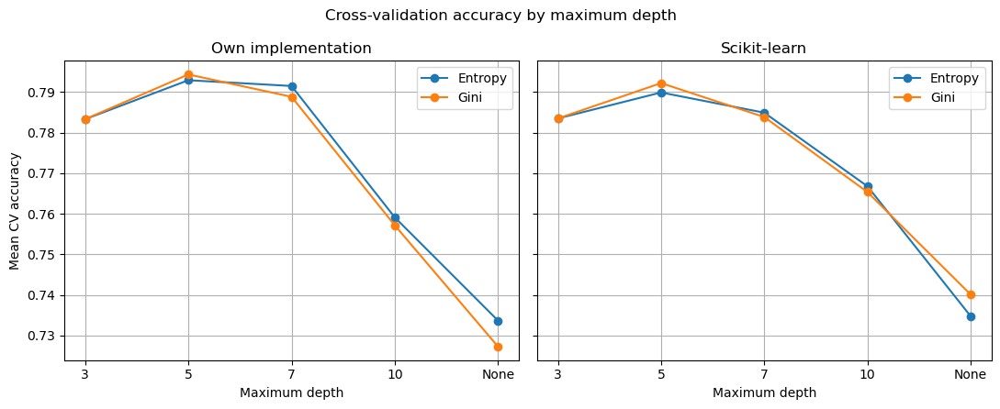

# Beslutningstrær fra bunnen av

Et beslutningstre (ID3) implementert fra bunnen av i Python med bare NumPy, brukt til å predikere hvilke kunder i et telekomselskap som slutter (churn). Implementasjonen sammenlignes med `DecisionTreeClassifier` fra scikit-learn under helt like betingelser.

Prosjekt 1 i **INF264 – Maskinlæring** ved Universitetet i Bergen, høsten 2026. Hele rapporten (engelsk) ligger i `rapport_decision_tree.pdf`.

<p align="center">
  
</p>

## Data

7032 kunder med 19 variabler: kontraktstype, hvor lenge kunden har vært kunde (`tenure`), månedlig og total pris, og hvilke tilleggstjenester kunden har. Kategoriske variabler er allerede kodet som heltall. Målvariabelen `Churn` er 1 hvis kunden sluttet. Klassene er ubalanserte: 27 % av kundene sluttet.

## Resultater

Begge implementasjonene valgte samme hyperparametere, `criterion="gini"` og `max_depth=5`, og presterer nesten likt på testsettet (1407 kunder):

| Modell | CV-accuracy | Test-accuracy | Test-F1 (churn) |
| --- | --- | --- | --- |
| Egen implementasjon | 0,794 | **0,783** | 0,525 |
| scikit-learn | 0,792 | 0,782 | 0,549 |

## Implementasjon

`DecisionTree` i `decision_tree.py` har samme grensesnitt som scikit-learn (`fit` og `predict`):

- **ID3, rekursivt:** i hver node velges variabelen med størst informasjonsgevinst, og dataene deles i to.
- **Urenhetsmål:** entropi eller Gini, valgt med `criterion`.
- **Splittpunkt:** medianen av variabelen. Det gir én kandidat per variabel, og treet blir raskt å trene.
- **Stoppkriterier:** alle observasjoner har samme klasse, alle variabelverdier er like, maks dybde er nådd, eller ingen variabel gir en gyldig splitt (kan skje når mange har samme verdi som medianen).
- **Permutasjonsviktighet:** egen implementasjon etter scikit-learn sin algoritme. Hver variabel stokkes 30 ganger, og fallet i accuracy måles.

## Metode

- **Splitt:** 80/20 trening og test, stratifisert på churn. Testsettet brukes bare én gang, helt til slutt.
- **Modellvalg:** 5-fold stratifisert kryssvalidering på treningssettet over `max_depth` ∈ {3, 5, 7, 10, None} og entropi/Gini.
- **Rettferdig sammenligning:** begge implementasjonene kjøres gjennom samme funksjon med samme folder, samme grid og samme mål.

## Funn

- **Dybde betyr mye, urenhetsmål lite.** Accuracy øker fra dybde 3 til 5 og faller deretter til 0,73 for et fullt utvokst tre, et tydelig tegn på overtilpasning. Forskjellen mellom entropi og Gini er under 0,003.
- **Egen implementasjon er like god som scikit-learn.** Forskjellen i test-accuracy er under 0,001.
- **Accuracy gir et for pent bilde.** F1 for churn er bare rundt 0,53, fordi modellen finner mye færre av kundene som faktisk slutter enn de 78 % riktige skulle tilsi. Det er en følge av de ubalanserte klassene og at modellvalget ble gjort med accuracy.
- **Fem variabler bærer modellen:** `OnlineSecurity`, `tenure`, `MonthlyCharges`, `TotalCharges` og `Contract`. Å stokke en av dem senker accuracy med 2,5–3,3 prosentpoeng. Ti variabler, blant dem `gender` og `PaymentMethod`, brukes ikke av treet i det hele tatt.

## Filer

```
├── decision_tree.py               # DecisionTree-klassen og permutation_importance
├── run_experiments.ipynb          # modellvalg, testevaluering og figurer
├── rapport_decision_tree.pdf      # rapport (engelsk)
└── img/                           # figurer
```

## Kjøring

```bash
pip install numpy pandas matplotlib scikit-learn jupyter
jupyter notebook run_experiments.ipynb
```

Legg `churn-data.csv` i samme mappe som notebooken. Alle tilfeldige steg bruker `random_state=42`, så alle tall i rapporten kan reproduseres.

## Forfatter

Eirik Aarrestad – bachelor i statistikk og data science, UiB
